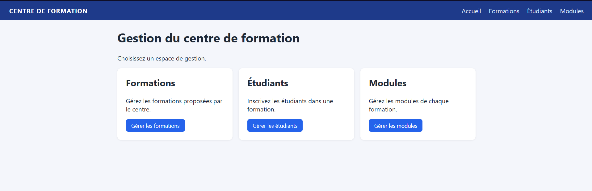
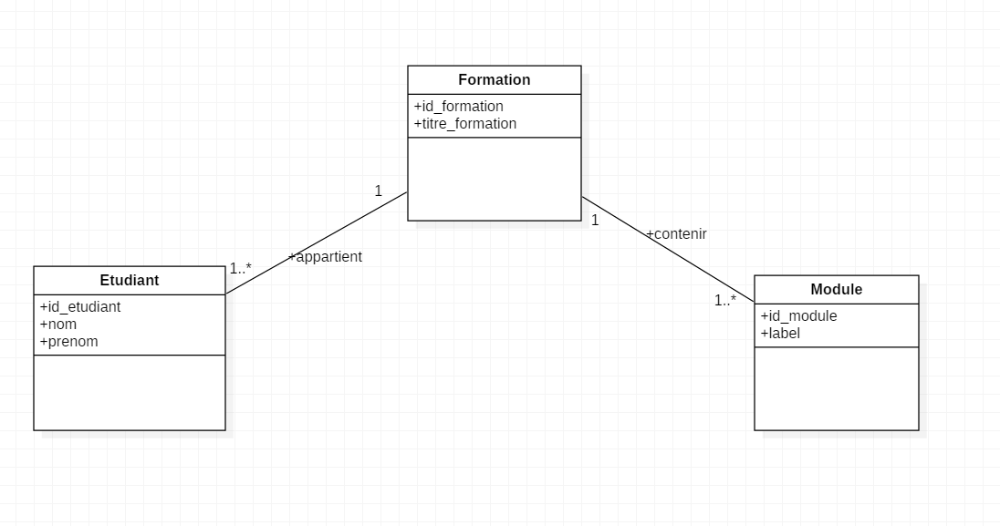
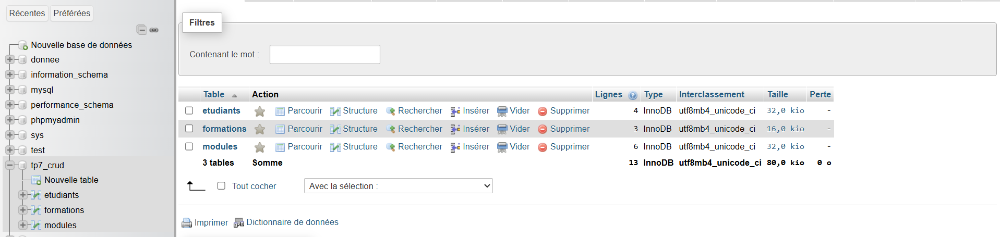
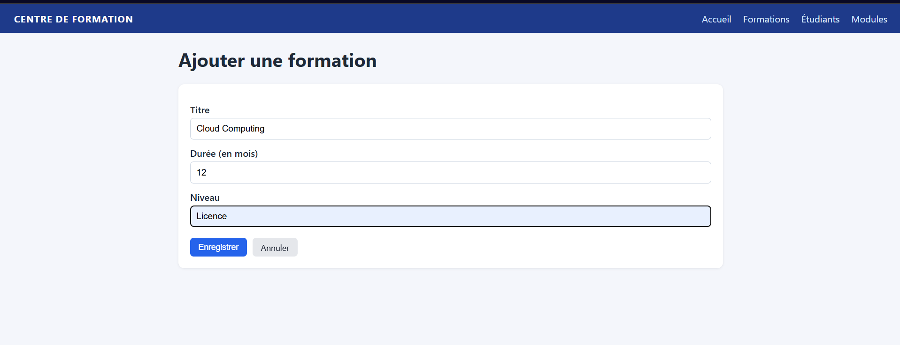
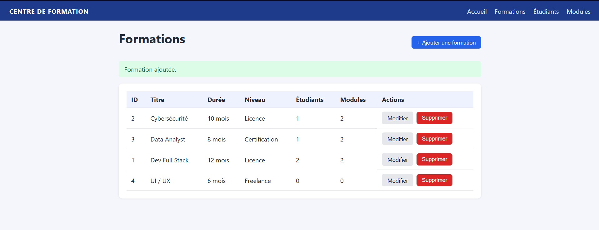
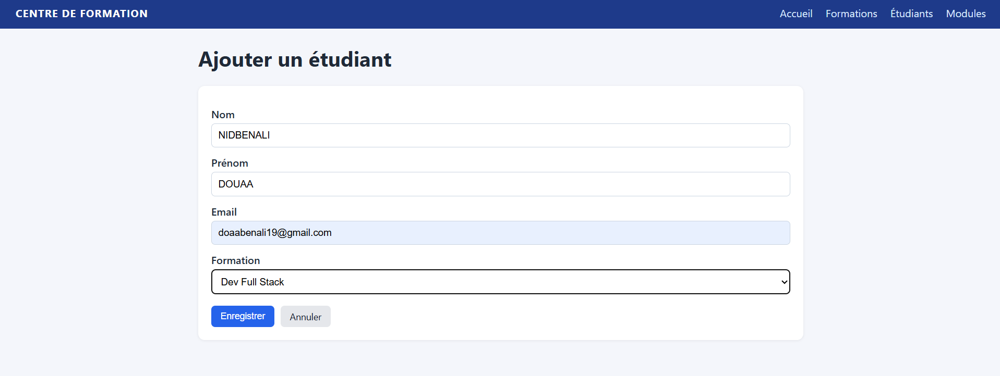
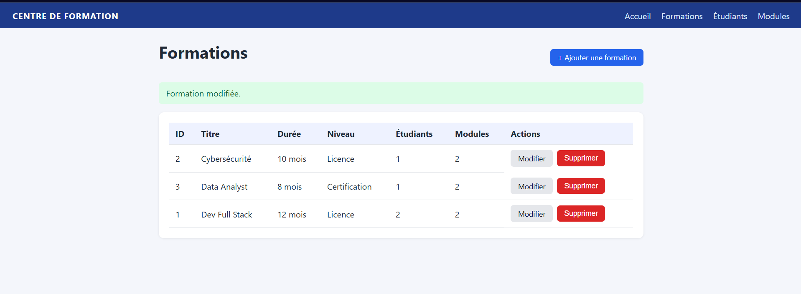
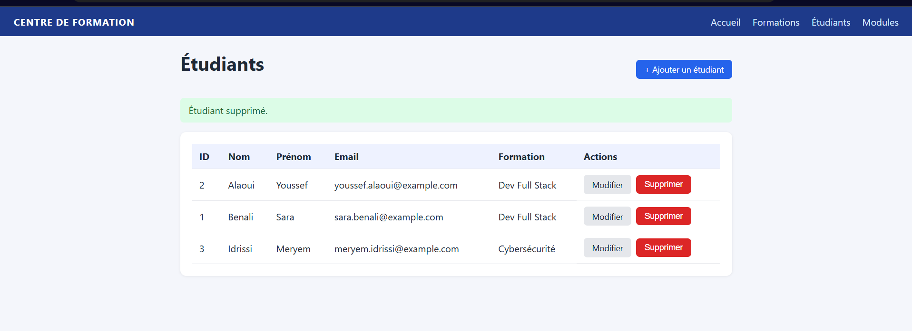
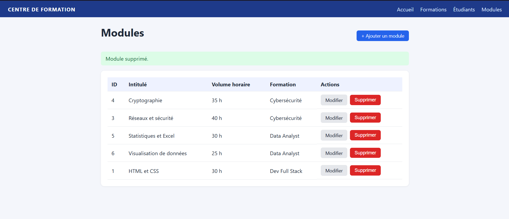
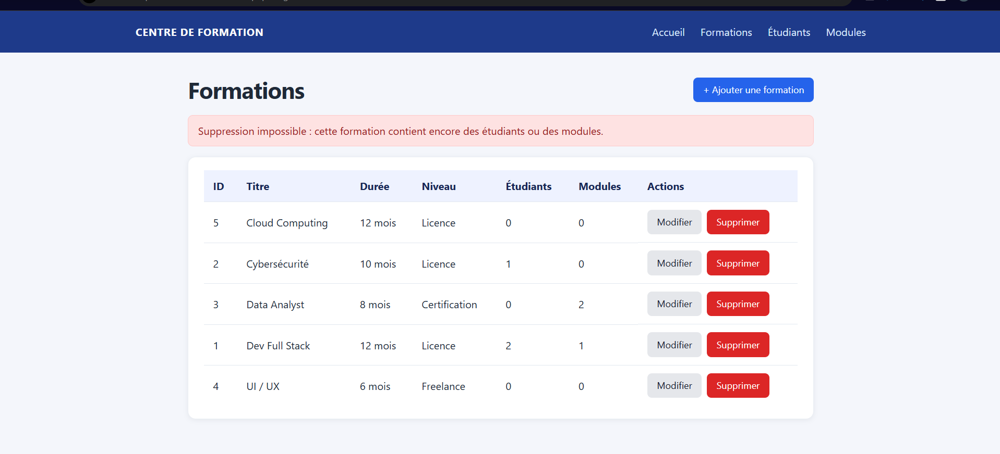

# TP7 - CRUD multi-entités (Centre de formation)

Application web PHP / PDO / MySQL pour gérer les **formations**, les **étudiants** et les **modules** d'un centre de formation.

## Aperçu

L'accueil donne accès aux trois espaces de gestion. Chaque espace permet de consulter, ajouter, modifier et supprimer ses données.



*Cette page sert de point de départ à l'application. Les trois cartes et la barre de navigation dirigent vers les espaces Formations, Étudiants et Modules ; aucun enregistrement n'est modifié depuis l'accueil.*

## Règles métier

- Un centre propose plusieurs formations.
- Une formation accueille plusieurs étudiants ; chaque étudiant appartient à une seule formation.
- Une formation contient plusieurs modules ; chaque module appartient à une seule formation.

## Modèle de données



*Réalisé avec StarUML, ce diagramme présente la conception générale et les liens entre les trois entités. Il ne détaille pas tous les champs de la base : les noms exacts des colonnes réellement utilisés par l'application sont indiqués dans le tableau ci-dessous.*

| Table        | Clé primaire   | Autres attributs                      | Clé étrangère                        |
|--------------|----------------|---------------------------------------|--------------------------------------|
| `formations` | `id_formation` | `titre`, `duree_mois`, `niveau`       | –                                    |
| `etudiants`  | `id_etudiant`  | `nom`, `prenom`, `email`              | `id_formation` → `formations`        |
| `modules`    | `id_module`    | `intitule`, `volume_horaire`          | `id_formation` → `formations`        |

Cardinalités : Formation **1 — N** Étudiants et Formation **1 — N** Modules. Les clés étrangères sont côté « N ».

Les clés étrangères utilisent `ON DELETE RESTRICT` : une formation qui contient encore des étudiants ou des modules ne peut pas être supprimée (un message d'erreur s'affiche).



*La base `tp7_crud` contient les trois tables nécessaires au CRUD : `formations`, `etudiants` et `modules`. Les étudiants et les modules sont reliés à une formation par `id_formation`, ce qui permet aux listes d'afficher le titre de leur formation et à la base de protéger les relations lors d'une suppression.*

## Prérequis

- XAMPP (Apache + MySQL/MariaDB + PHP 8)

## Installation

1. Copier le dossier `tp7-crud` dans `C:\xampp\htdocs\`.
2. Démarrer **Apache** et **MySQL** dans le panneau de contrôle XAMPP.
3. Ouvrir `http://localhost/phpmyadmin`, onglet **Importer**, choisir `database.sql` puis **Exécuter**.
   La base `tp7_crud`, les 3 tables et des données de test sont créées.
4. Ouvrir `http://localhost/tp7-crud/`.

La connexion (`database/connexion.php`) utilise `root` sans mot de passe, la configuration par défaut de XAMPP. À modifier si besoin.

## Utilisation

1. Démarrer Apache et MySQL dans XAMPP. La base `tp7_crud` doit avoir été créée en important `database.sql`, et les paramètres de connexion dans `database/connexion.php` doivent correspondre à votre configuration MySQL. Voir la section [Installation](#installation) si nécessaire.
2. Ouvrir `http://localhost/tp7-crud/`. 
3. Depuis l'accueil ou la barre de navigation, ouvrir **Formations**, **Étudiants** ou **Modules**.
4. Créer d'abord une formation. Les formulaires d'ajout d'étudiants et de modules nécessitent une formation existante et permettent de la choisir dans une liste.
5. Dans chaque liste, utiliser **+ Ajouter** pour créer un élément. Utiliser **Modifier** pour changer ses informations ; le formulaire reprend les valeurs déjà enregistrées.
6. Pour supprimer un étudiant ou un module, cliquer sur **Supprimer** et confirmer l'action. La liste s'actualise ensuite avec un message de résultat.
7. Une formation ne peut être supprimée que si aucun étudiant ni module ne lui est rattaché. Si la suppression est refusée, supprimer ou réaffecter d'abord ces éléments, puis réessayer.

## Structure du projet

```
tp7-crud/
├── index.php               Page d'accueil (3 liens)
├── database.sql            Création de la base, des tables et des données de test
├── database/
│   └── connexion.php       Connexion PDO (require_once dans toutes les pages)
├── formations/             index.php, create.php, edit.php, delete.php
├── etudiants/              index.php, create.php, edit.php, delete.php
├── modules/                index.php, create.php, edit.php, delete.php
├── assets/css/style.css    Styles
└── docs/                   Captures d'écran de l'application et de la base
```

## Fonctionnalités

- **READ** : tableaux HTML via `SELECT` + `fetchAll(PDO::FETCH_ASSOC)`. Les listes d'étudiants et de modules affichent le **titre de la formation** grâce à un `INNER JOIN`.
- **CREATE** : formulaires POST, requêtes préparées (`prepare` / `execute`), redirection vers la liste. Une liste `select` alimentée depuis MySQL permet de choisir la formation.
- **UPDATE** : formulaire prérempli, `UPDATE ... WHERE id = :id`, redirection vers la liste.
- **DELETE** : requête préparée avec `WHERE id = :id` (envoi en POST après confirmation), redirection vers la liste.

## Captures et parcours

### Ajouter une formation



*L'utilisateur saisit le titre, la durée en mois et le niveau de la formation. Le serveur vérifie que les champs sont renseignés et que la durée est positive, puis enregistre les données avec une requête préparée. Après l'enregistrement, l'utilisateur revient à la liste des formations.*



*Cette capture montre le résultat de l'ajout : la nouvelle formation apparaît dans le tableau et un message confirme l'opération. Les colonnes Étudiants et Modules comptent les éléments rattachés à chaque formation ; elles restent à zéro tant qu'aucun élément n'y est associé.*

### Ajouter un étudiant



*Le formulaire demande le nom, le prénom et l'adresse e-mail, puis propose les formations déjà créées dans une liste déroulante. Le serveur contrôle les champs et le format de l'adresse avant d'insérer l'étudiant avec l'identifiant de sa formation.*

### Modifier une formation



*Après avoir choisi Modifier, le formulaire reprend les valeurs existantes pour permettre leur correction. Cette capture montre le retour à la liste avec le message de confirmation ; la modification est enregistrée en base avec une requête `UPDATE` ciblant uniquement l'identifiant de cette formation.*

### Supprimer un étudiant ou un module



*La suppression est demandée depuis la liste, avec une confirmation avant l'envoi du formulaire. L'identifiant de l'étudiant est transmis en POST, puis une requête préparée supprime uniquement cet étudiant ; le message et la liste actualisée indiquent le résultat.*



*Le même parcours est appliqué aux modules : l'utilisateur confirme l'action, puis le serveur supprime le module visé grâce à son identifiant et redirige vers la liste. La capture montre le message de réussite et les modules qui restent enregistrés.*

### Suppression d'une formation refusée



*Ici, la suppression d'une formation est refusée parce qu'elle possède encore des étudiants ou des modules associés. La contrainte `ON DELETE RESTRICT` de la base empêche de supprimer la formation et de laisser des enregistrements orphelins. L'application intercepte cette erreur et affiche un message explicite dans la liste ; il faut d'abord supprimer ou réaffecter les éléments liés.*

## Scénario de test (activité 12)

1. Accueil : les 3 liens mènent aux 3 listes ; la barre de navigation permet de revenir à l'accueil.
2. Les 3 listes s'affichent avec les données de test, la formation étant lisible (titre, pas un numéro).
3. Ajouter une formation, un étudiant, un module (les `select` proposent les formations existantes).
4. Modifier chaque élément : le formulaire est prérempli, la modification apparaît dans la liste.
5. Supprimer un étudiant et un module : seul l'élément ciblé disparaît.
6. Supprimer une formation qui contient des étudiants/modules : refus avec message d'erreur.
7. Supprimer une formation vide : suppression acceptée.

## Sécurité

- Requêtes préparées PDO (protection contre l'injection SQL).
- `htmlspecialchars()` sur toutes les données affichées (protection XSS).
